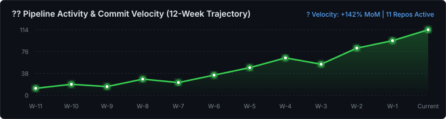

<div align="center">

# ⚡ ZERO DAY DUO
### *Autonomous Detection Engineering • Resilient Telemetry • Threat Intelligence*

[](#)
[](#)
[](#)
[](#)

<br/>

> **ZeroDayDuo** is a specialized engineering organization building high-throughput log sessionization, automated threat detection pipelines, resilient mail infrastructure defenses, and multi-agent supervisory networks.

</div>

---

## 📊 Activity & Development Velocity

All primary codebases, production deployments, and detection rulesets are maintained in private repositories to protect operational security signatures, live agent tokens, and enterprise infrastructure telemetry.

### 🐍 Contribution Activity Matrix
<div align="center">


<br/>


</div>

### 📈 Multi-Repo Commit Cadence & Telemetry Spikes
<div align="center">



</div>

---

## 🛡️ Core Engineering Pillars

```
┌────────────────────────────────────────────────────────────────────────┐
│                        ZERODAYDUO ARCHITECTURE                         │
└───────────────────────────────────┬────────────────────────────────────┘
                                    │
    ┌───────────────────────────────┼───────────────────────────────┐
    ▼                               ▼                               ▼
┌────────────────────────┐      ┌────────────────────────┐      ┌────────────────────────┐
│  DETECTION ENGINEERING │      │  SESSIONIZATION & SIEM │      │  AUTONOMOUS AGENTS     │
│  • Wazuh 4.x Rulesets  │      │  • Multi-Threaded MDA  │      │  • Multi-Agent Protocol│
│  • YARA Signatures     │      │  • Rsyslog Log Stream  │      │  • Teacher / Agent_GG  │
│  • Zero-Day Scanners   │      │  • OpenSearch 2.x Dash │      │  • Agent_G / Agent_OMP │
└────────────────────────┘      └────────────────────────┘      └────────────────────────┘
```

### 1. Detection Engineering & SIEM / XDR
* **Real-Time Wazuh Integration**: Custom decoders and high-severity rule cascades (Rules 100130–100133) identifying threat vectors, credential stuffing, and malicious payloads.
* **Antivirus & Antispam Telemetry**: Real-time extraction of Sophos SSSP antivirus actions (`CLEAN`, `QUARANTINED`, virus signatures) and Bayesian antispam verdicts (`SPAM-B`, `SPAM`, targeted mailboxes).
* **OpenSearch Visualization Engine**: Hardened Vislib-compatible dashboards with auto time-bucketing, multi-metric aggregation, and incident transcript tracking.

### 2. Stream Sessionization & Ingestion Engines
* **IceWarp Sessionizer v15**: High-speed streaming engine that reconstitutes asynchronous multi-thread syslog feeds (`smtp`, `control`, `pop3`) into unified JSON session objects with state persistence across log rotations.
* **Push Notification Decoding**: Real-time interception and decoding of control notifications (`RAW push notification:SMTP`) to capture message subjects, senders, and delivery metadata.
* **Hardened Rsyslog Listeners**: Zero-loss UDP/TCP spooling with sub-second pipeline throughput.

### 3. Distributed Autonomous Multi-Agent Fleet
Our engineering operations follow a strict, file-based multi-agent coordination protocol:
* **`Teacher` / Planner**: Orchestrator executing the governance layer, task decomposition, and dispatching.
* **`agent_gg` (IDE)**: Local workstation engineering, architectural design, syntax validation, and testing.
* **`agent_g` (FL-T)**: Remote autonomous Linux agent executing directly on telemetry servers (`65.109.216.202`) for live container lifecycles and service health.
* **`agent_omp` (FL-T)**: Specialized autonomous harness for high-concurrency model execution.

---

## 💻 Tech Stack & Infrastructure

<div align="center">

| Domain | Technologies |
| :--- | :--- |
| **SIEM & Indexing** | `Wazuh Manager` • `Wazuh Agent` • `OpenSearch 2.x` • `OpenSearch Dashboards` • `Elasticsearch` |
| **Languages** | `Python 3.12` • `Bash / POSIX Shell` • `PowerShell` • `Go` • `Markdown` |
| **OS & Daemons** | `Rocky Linux 9` • `Debian / Ubuntu` • `Windows Server` • `Rsyslog` • `Systemd` |
| **Automation & Ops**| `Ansible` • `Docker` • `Git` • `TUI (Terminal UI)` • `SSH-Agent Enclaves` |
| **Security & Forensics** | `YARA` • `Sophos SSSP` • `PCRE2 RegEx Engines` • `IPS / Intrusion Prevention` |

</div>

---

## 🔒 Security & Responsible Disclosure

ZeroDayDuo adheres to coordinated, responsible vulnerability disclosure:

* **Security Inquiries**: For security questions, auditing requests, or vulnerability disclosures, please reach out via our private security communication channels or verified maintainers.
* **Repository Access**: Access to private repositories is restricted to active organization members and authorized enterprise security collaborators.

<div align="center">

<sub>Built with ⚡ by <b>ZeroDayDuo</b> • Autonomous Threat Defense &amp; Detection Engineering</sub>

</div>
